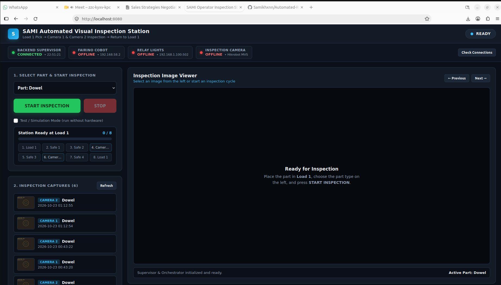

# Automated-Robot-Visual-Inspection-System
Automated 6-DOF cobot visual inspection platform orchestrating Fairino robotics, Hikrobot MVS cameras, and Modbus TCP lighting via a live web HMI.
# SAMI — Automated Cobot Visual Inspection Station


**SAMI** is an industrial robotic optical inspection platform that coordinates a **6-DOF Fairino collaborative robot**, **Hikrobot GigE/USB3 machine vision cameras**, and a **30-channel Modbus TCP lighting relay** through declarative YAML part profiles and a real-time **Operator Web HMI**.

---

## Operator Web HMI Preview

<!-- ===================================================================== -->
<!-- REPLACE THE PATH BELOW WITH YOUR SCREENSHOT (e.g. docs/ui_preview.png) -->
<!-- ===================================================================== -->
<p align="center">
  
</p>

> *📸 **To add your screenshot:** Save a screenshot of `http://localhost:8080` as `docs/ui_screenshot.png` (or update the `` path above).*

---

## Key Features

- **8-Stage Pick-Inspect-Place Trajectory (`Load 1 → Camera 1 → Camera 2 → Load 1`):**
  Executes collision-free waypoint sequences with per-step motion types (`MoveJ`, `MoveL`, `MoveCart`), lighting zones, and camera exposure settings defined entirely in YAML (`dowel.yaml`, `hub.yaml`).
- **Closed-Loop Pose Stability Gating:**
  Polls real-time joint angles (`GetActualJointPosDegree`) and Cartesian TCP poses (`GetActualTCPPose`) until 5 consecutive readings settle within **0.2°** / **0.5 mm** before triggering camera acquisition—eliminating motion blur.
- **Zero-Copy Machine Vision Pipeline:**
  Interfaces directly with the **Hikrobot MVS C SDK** via Python `ctypes` (`camera.py`) for hardware enumeration, manual microsecond exposure control, and `BGR8` pixel buffer conversion into OpenCV/NumPy arrays.
- **Raw Binary Modbus TCP Lighting Driver:**
  Implements custom Function Code `0x05` (Write Single Coil) packet framing over TCP sockets (`lights.py`) to switch up to 30 relay channels per inspection station.
- **Hardware-in-the-Loop (HIL) Simulation Mode:**
  Built-in digital-twin strategy (`SimulatedHardwareStrategy`) generates synthetic OpenCV inspection captures with target reticles and metadata overlays, enabling full-stack testing without physical hardware connected.
- **Real-Time Safety Watchdog & Operator HMI:**
  Multi-threaded web server (`web_ui.py`) and supervisor (`supervisor.py`) with background TCP/SDK health probing, live step-duration telemetry, automatic image gallery updates, and immediate emergency stop (`StopMotion`).

---

## System Architecture & Design Patterns

The backend (`orchestrator.py` & `supervisor.py`) is built around **5 core software design patterns**:

```
┌──────────────────────────────────────────────────────────────────────────┐
│                        Operator Web HMI (web_ui.py)                      │
│       Live Status Bar • Part Selector • 8-Step Progress • Image Viewer   │
└───────────────────────────────────┬──────────────────────────────────────┘
                                    │ REST API (/api/status, /api/scan/*)
                                    ▼
┌──────────────────────────────────────────────────────────────────────────┐
│                     StationSupervisor (supervisor.py)                    │
│     Background Watchdog Thread • TCP/MVS Health Probes • E-Stop Guard    │
└───────────────────────────────────┬──────────────────────────────────────┘
                                    │ Subscribes to EventBus (1. Observer)
                                    ▼
┌──────────────────────────────────────────────────────────────────────────┐
│                  InspectionOrchestrator (orchestrator.py)                │
│   • 2. State Machine (StationState: IDLE → CONNECTING → CAPTURING ...)   │
│   • 4. Facade Pattern (InspectionStation context manager)                │
│   • 5. Command Pattern (InspectionStepCommand per YAML waypoint)         │
└───────────────────┬───────────────────────────────────┬──────────────────┘
                    │ 3. Strategy Pattern               │
        ┌───────────┴───────────┐           ┌───────────┴───────────┐
        ▼                       ▼           ▼                       ▼
┌───────────────────────────────┐   ┌──────────────────────────────────────┐
│     RealHardwareStrategy      │   │      SimulatedHardwareStrategy       │
├───────────────────────────────┤   ├──────────────────────────────────────┤
│ • FairinoController (XML-RPC) │   │ • Synthetic OpenCV Reticle Generator │
│ • LightsController (Modbus)   │   │ • Simulated Timing & Telemetry       │
│ • CameraCapture (Hikrobot MVS)│   │ • Zero Hardware Dependencies         │
└───────────────────────────────┘   └──────────────────────────────────────┘
```

---

## Project Structure

```text
sami_project/
├── web_ui.py             # Multi-threaded HTTP server, REST API & Operator Web HMI
├── supervisor.py         # Safety watchdog, background hardware health prober & state manager
├── orchestrator.py       # 8-step inspection engine (Observer, State, Strategy, Facade, Command)
├── cobot_controller.py   # Fairino 6-DOF cobot driver (MoveJ, MoveL, MoveCart + stability polling)
├── camera.py             # Hikrobot MVS GigE/USB3 camera wrapper via ctypes & OpenCV
├── lights.py             # Raw Modbus TCP client (Function 0x05 Write Single Coil)
├── dowel.yaml            # 8-position inspection profile for "Dowel" part
├── hub.yaml              # 8-position inspection profile for "Hub" part
└── captures/             # Timestamped inspection images organized by part
    ├── object_1/
    └── object_2/
```

---

## Prerequisites & Installation

### 1. Python Dependencies
```bash
pip install opencv-python numpy pyyaml
```

### 2. Hardware SDKs *(Optional — only required for physical Hardware Mode)*
- **Fairino Cobot Python SDK:** Expected at `/home/user2/Downloads/fairino-python-sdk-main/linux` (configurable via `FAIRINO_SDK_LINUX_DIR` in `cobot_controller.py`).
- **Hikrobot MVS SDK:** Expected at `/opt/MVS/Samples/64/Python` (configurable in `camera.py`).

> **Note:** You can run the entire system in **Simulation Mode** out of the box without either hardware SDK installed.

---

## Quick Start

### 1. Launch the Operator Web HMI (Recommended)
```bash
python3 web_ui.py --host 0.0.0.0 --port 8080
```
Open **`http://localhost:8080`** in your browser:
1. Select a part profile (**Dowel** or **Hub**) from the dropdown.
2. Check **"Test / Simulation Mode"** if running without physical hardware.
3. Click **START INSPECTION** to watch the 8-step cycle and view live captures.

---

### 2. Run an Inspection Cycle via CLI
```bash
# Run in Simulation Mode (no hardware required)
python3 orchestrator.py dowel.yaml --simulate

# Run on physical hardware using hub.yaml
python3 orchestrator.py hub.yaml
```

---

### 3. Standalone Cobot Motion & Diagnostics CLI
`cobot_controller.py` includes a full CLI for jogging, status checks, and testing YAML waypoints:

```bash
# Read current 6-DOF joint angles (deg) and Cartesian TCP pose
python3 cobot_controller.py --config dowel.yaml --status

# Move to a single named position from YAML
python3 cobot_controller.py --config dowel.yaml --position position_4

# Execute a direct MoveJ command (6 joint angles in degrees)
python3 cobot_controller.py --move-j 0 -45 90 -45 90 0 --vel 20

# Execute a direct MoveCart or MoveL command (X Y Z RX RY RZ)
python3 cobot_controller.py --move-cart 350.0 -120.0 240.0 180.0 0.0 90.0
```

---

## Adding a New Part Profile (YAML)

Drop any `.yaml` file with an `inspection_positions` block into the project root—the Web HMI automatically discovers it via `/api/objects`:

```yaml
object_name: CustomPart

robot:
  ip: "192.168.58.2"
  tool: 0
  user: 0
  vel: 20.0

relay:
  ip: "192.168.1.100"
  port: 502
  unit_id: 1
  enabled_channels: [1, 2, 3, 4]

camera:
  serial_number: ""
  output_dir: "captures/custom_part"
  lighting_delay_sec: 0.5
  frame_timeout_ms: 2000

inspection_positions:
  position_1:
    label: "Load 1 (Pick / Start)"
    move_type: "MoveJ"
    capture: false
    joints: [0.0, -45.0, 90.0, -45.0, 90.0, 0.0]
    tolerance_deg: 2.0

  position_4:
    label: "Camera 1 Inspection"
    move_type: "MoveJ"
    capture: true
    joints: [30.0, -30.0, 60.0, 0.0, 30.0, 0.0]
    tolerance_deg: 2.0
    lights: [1, 2]
    exposure_time_us: 10000
```

---

## REST API Reference

| Method | Endpoint | Description |
| :--- | :--- | :--- |
| `GET` | `/api/status` | Returns station state, active step, heartbeat, logs, and hardware connection status. |
| `GET` | `/api/objects` | Lists all discovered YAML part profiles and their step definitions. |
| `GET` | `/api/images?config_file=<file>` | Lists captured inspection images sorted newest-first. |
| `GET` | `/api/image?path=<rel_path>` | Streams a captured `.jpg` inspection image. |
| `POST` | `/api/scan/start` | Starts an inspection cycle (`{"config_file": "dowel.yaml", "simulate": true}`). |
| `POST` | `/api/scan/stop` | Triggers an immediate emergency motion stop and halts the active cycle. |
| `POST` | `/api/connections/check` | Forces an immediate non-blocking probe of the Cobot, Relay, and Camera. |
